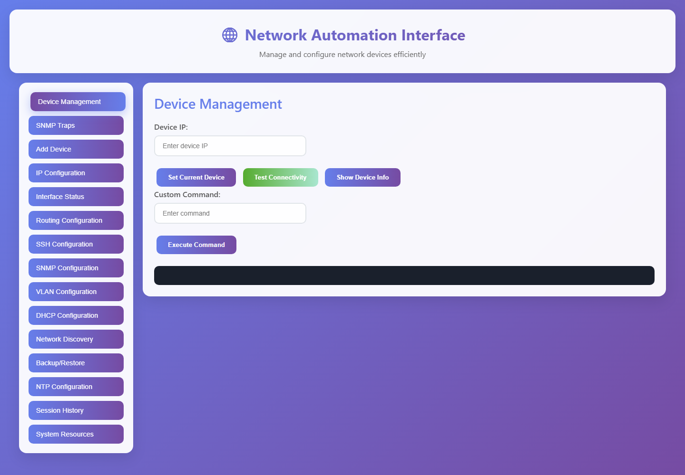
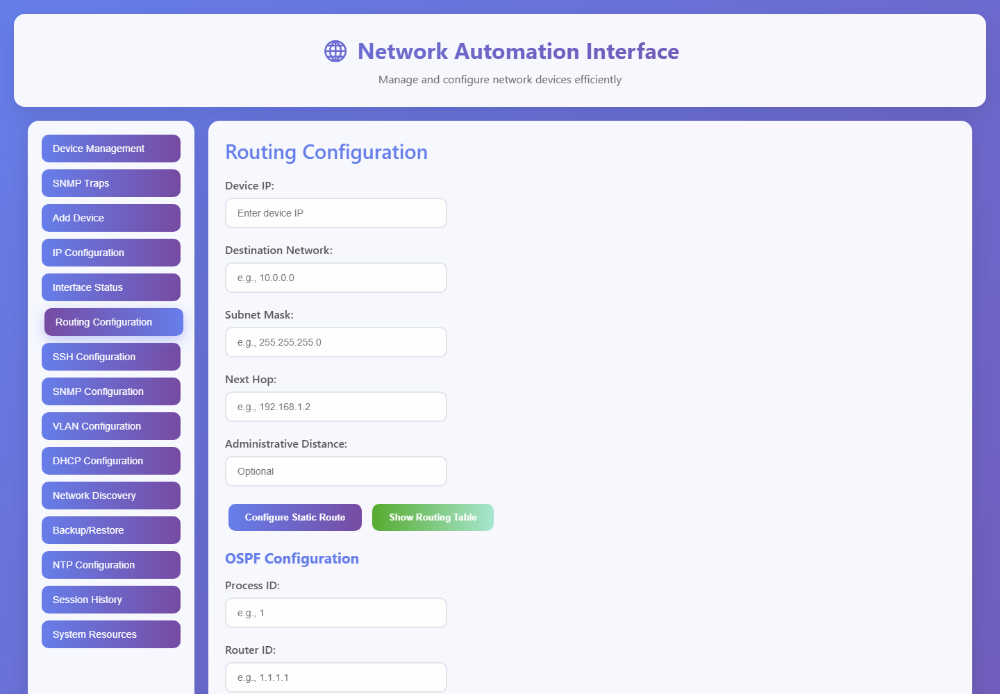
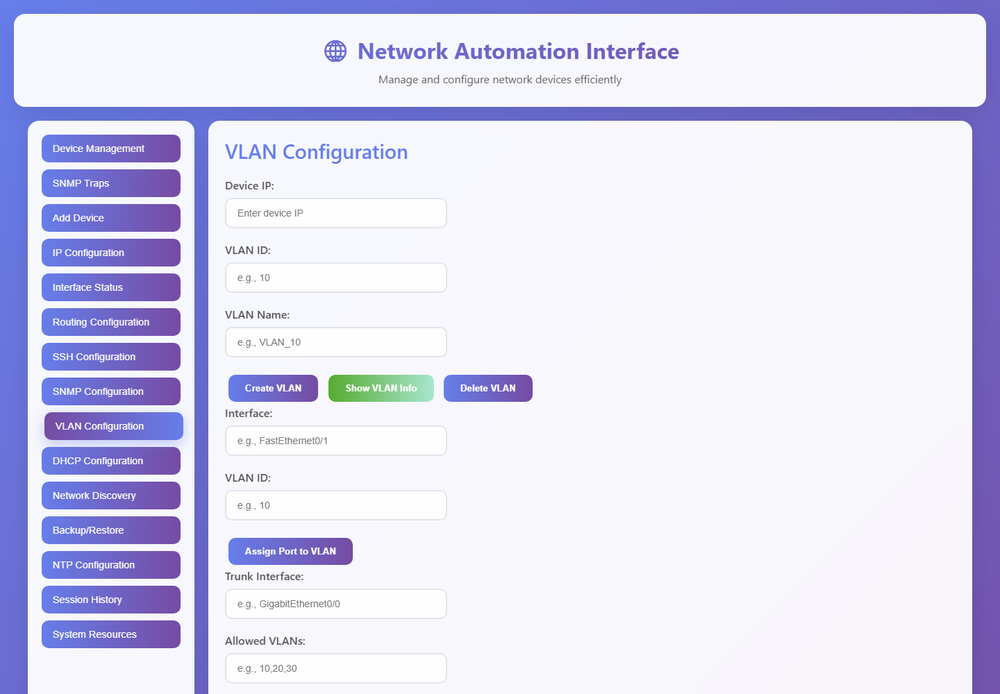
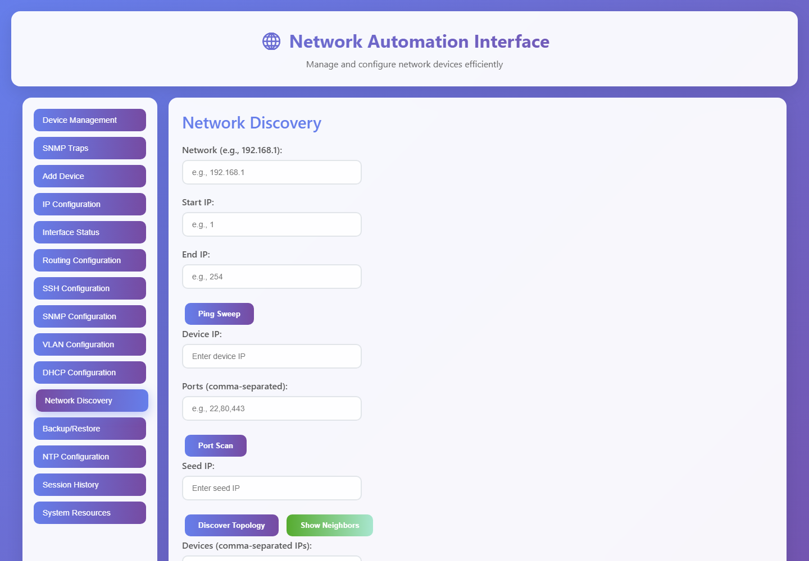
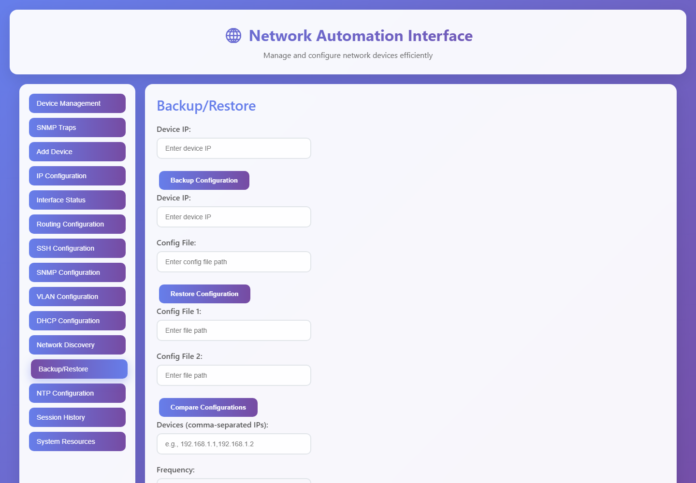
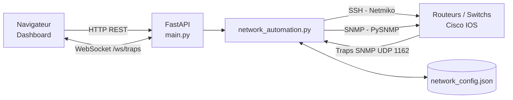

<div align="center">



# 🌐 GNS3 Network Automation

**Interface web d'automatisation et de supervision pour équipements Cisco IOS dans GNS3**


[Présentation](#-présentation) · [Fonctionnalités](#-fonctionnalités) · [Aperçu](#-aperçu) · [Installation](#-installation) · [Configuration](#-configuration) · [API](#-api) · [Sécurité](#-sécurité) · [Licence](#-licence)

</div>

---

## 📖 Présentation

**GNS3 Network Automation** est un tableau de bord web développé dans le cadre d'un **stage d'initiation**. Il permet de configurer, administrer et superviser des routeurs et switchs **Cisco IOS** d'un lab **GNS3** sans saisir les commandes CLI une par une.

L'application combine :

- **FastAPI** pour l'API REST et le serveur web ;
- **Netmiko** pour les connexions SSH vers les équipements ;
- **PySNMP** pour la découverte SNMP et la réception de traps en temps réel ;
- **WebSocket** pour remonter les traps SNMP au navigateur ;
- **Bootstrap 5** et JavaScript pour le dashboard.

> ⚠️ **Projet pédagogique** : il est prévu pour un laboratoire GNS3 isolé. Ne l'exposez pas directement sur Internet sans ajouter d'authentification et de HTTPS.

---

## ✨ Fonctionnalités

| Domaine | Fonctionnalités |
|---|---|
| **Équipements** | Ajout d'un équipement, test de connexion SSH, informations système, commande personnalisée, sélection de l'équipement courant |
| **Interfaces** | État des interfaces, configuration d'adresse IP, loopback, activation/désactivation, configuration en masse |
| **Routage** | Route statique, **OSPF**, **EIGRP**, **BGP**, affichage de la table de routage et des protocoles |
| **VLAN** | Création/suppression de VLAN, affectation d'un port, configuration trunk, VLAN sur plusieurs switchs |
| **DHCP** | Création de pools DHCP avec passerelle et DNS |
| **Découverte** | Ping sweep, scan de ports, découverte SNMP, voisins CDP/LLDP, topologie |
| **SNMP** | Découverte SNMP, configuration SNMPv2c, réception de **traps en temps réel** via WebSocket |
| **Sauvegarde** | Backup de configuration, restauration, comparaison de deux configurations, sauvegarde planifiée |
| **Multi-équipements** | Commandes groupées, configuration groupée, VLAN réseau complet |
| **NTP** | Synchronisation de l'heure et affichage du statut NTP |
| **Supervision** | Historique des sessions, ressources système (CPU, mémoire, processus) |

---

## 📸 Aperçu

### Dashboard principal


| Routage (statique, OSPF, EIGRP, BGP) | VLAN et trunk |
|---|---|
|  |  |

| Découverte réseau | Sauvegarde / restauration |
|---|---|
|  |  |

---

## 🏗️ Architecture



Le frontend est servi par FastAPI depuis le dossier `static/`. Les actions sont envoyées à l'API REST ; les résultats sont renvoyés en JSON et affichés dans la zone de sortie du dashboard.

---

## 🧰 Stack technique

| Composant | Version | Rôle |
|---|---|---|
| Python | 3.10 / 3.11 | Langage principal |
| FastAPI | 0.116.1 | API REST et serveur web |
| Uvicorn | 0.35.0 | Serveur ASGI |
| Netmiko | 4.6.0 | Connexions SSH multi-constructeurs |
| PySNMP | 4.4.12 | SNMP (découverte, traps) |
| Schedule | 1.2.2 | Sauvegardes planifiées |
| Bootstrap | 5.x | Interface responsive |
| JavaScript | Vanilla | Interactions et WebSocket |

---

## 📋 Prérequis

- **Python 3.10 ou 3.11** (testé avec Python 3.10) ;
- **GNS3** avec des images Cisco IOS (routeurs et switchs) ;
- **SSH activé** sur les équipements Cisco ;
- **SNMP** activé si vous utilisez la découverte ou les traps ;
- Git pour récupérer le projet.

---

## 🚀 Installation

### 1. Cloner le dépôt

```bash
git clone https://github.com/Oussamaelhilali2025/gns3-network-automation.git
cd gns3-network-automation
```

### 2. Créer l'environnement virtuel

**Windows (PowerShell / CMD) :**

```bat
python -m venv .venv
.venv\Scripts\activate
```

**Linux / macOS :**

```bash
python3 -m venv .venv
source .venv/bin/activate
```

### 3. Installer les dépendances

```bash
python -m pip install --upgrade pip
pip install -r requirements.txt
```

### 4. Créer le fichier de configuration local

**Windows :**

```bat
copy config.example.json network_config.json
```

**Linux / macOS :**

```bash
cp config.example.json network_config.json
```

### 5. Lancer l'application

```bat
set PYTHONUTF8=1
uvicorn main:app --reload --host 127.0.0.1 --port 8000
```

Sous Linux / macOS :

```bash
export PYTHONUTF8=1
uvicorn main:app --reload --host 127.0.0.1 --port 8000
```

Puis ouvrir :

- **Dashboard** : <http://127.0.0.1:8000/static/index.html>
- **Documentation API (Swagger)** : <http://127.0.0.1:8000/docs>

> 💡 Sur Windows, `run.bat` crée automatiquement le venv, installe les dépendances et lance l'application.

---

## ⚙️ Configuration

Deux méthodes sont disponibles :

1. **Via l'interface** : onglet **Add Device**, puis saisir l'IP, le nom d'utilisateur, le mot de passe et le type d'équipement.
2. **Via le fichier** `network_config.json` (créé à partir de `config.example.json`).

Exemple de configuration :

```json
{
    "default_snmp_community": "public",
    "devices": {
        "192.168.1.10": {
            "username": "cisco",
            "password": "change-me",
            "secret": "",
            "device_type": "cisco_ios",
            "snmp_community": "public"
        }
    }
}
```

| Champ | Description |
|---|---|
| `username` / `password` | Identifiants SSH de l'équipement |
| `secret` | Mot de passe du mode privilégié (`enable`), facultatif |
| `device_type` | Type Netmiko (`cisco_ios`, `cisco_xe`, `cisco_nxos`, etc.) |
| `snmp_community` | Communauté SNMPv2c de l'équipement |

> 🔐 `network_config.json` contient des identifiants en clair. Il est **ignoré par Git** et ne doit jamais être publié.

---

## 🖥️ Utilisation

1. **Ajouter un équipement** dans l'onglet *Add Device*.
2. **Sélectionner l'équipement courant** avec son adresse IP, puis cliquer sur *Set Current Device*.
3. **Tester la connectivité SSH** avant toute configuration.
4. Utiliser les onglets pour configurer les interfaces, le routage, les VLAN, le DHCP, le NTP, etc.
5. Consulter les **traps SNMP** en temps réel dans l'onglet *SNMP Traps*.
6. Sauvegarder les configurations dans *Backup/Restore* et consulter l'historique des actions.

---

## 🔌 API

L'API expose une quarantaine de routes REST. La documentation interactive complète est disponible sur **`/docs`**.

| Méthode | Route | Description |
|---|---|---|
| `POST` | `/api/add_device` | Ajouter un équipement |
| `POST` | `/api/test_connectivity` | Tester la connexion SSH |
| `POST` | `/api/configure_interface_ip` | Configurer une adresse IP |
| `POST` | `/api/configure_ospf` | Configurer OSPF |
| `POST` | `/api/configure_eigrp` | Configurer EIGRP |
| `POST` | `/api/configure_bgp` | Configurer BGP |
| `POST` | `/api/create_vlan` | Créer un VLAN |
| `POST` | `/api/assign_port_to_vlan` | Affecter un port à un VLAN |
| `POST` | `/api/ping_sweep` | Balayage ping d'un réseau |
| `POST` | `/api/snmp_discovery` | Découverte SNMP |
| `POST` | `/api/backup_configuration` | Sauvegarder une configuration |
| `POST` | `/api/restore_configuration` | Restaurer une configuration |
| `WS` | `/ws/traps` | Recevoir les traps SNMP en temps réel |

---

## 🗂️ Structure du projet

```text
gns3-network-automation/
├── main.py                     # API FastAPI et routes REST
├── network_automation.py       # Logique Netmiko / PySNMP
├── static/
│   ├── index.html              # Dashboard
│   ├── bootstrap.min.css
│   ├── dashboard_graph.png
│   └── images/                 # Illustrations de l'interface
├── docs/
│   └── screenshots/            # Captures pour le README
├── config.example.json         # Modèle de configuration
├── requirements.txt
├── run.bat                     # Lancement automatique (Windows)
├── .gitignore
├── LICENSE
└── README.md
```

---

## 🔒 Sécurité

Ce projet est **pédagogique** et ne doit pas être exposé tel quel sur Internet.

- L'application **n'a pas d'authentification** : gardez-la sur `127.0.0.1` ou dans un réseau de lab isolé.
- Le middleware CORS autorise actuellement toutes les origines (`allow_origins=["*"]`). À restreindre en production.
- Les identifiants des équipements sont stockés **en clair** dans `network_config.json`. Protégez ce fichier et ne le versionnez jamais.
- La communauté SNMP par défaut est `public`. Changez-la dans votre lab.
- Pour un usage réel : ajoutez une authentification (JWT), HTTPS, une base de données chiffrée, SNMPv3 et des clés SSH.
- N'utilisez cet outil que sur des équipements que vous êtes autorisé à administrer.

---

## 🛠️ Dépannage

| Problème | Solution |
|---|---|
| `Config file not found` | Copier `config.example.json` vers `network_config.json` |
| `UnicodeEncodeError` au démarrage | Définir `PYTHONUTF8=1` avant de lancer Uvicorn |
| Timeout SSH | Vérifier l'IP GNS3, `ip ssh`, les identifiants et les ACL |
| Timeout SNMP | Vérifier la communauté, UDP 161 et les ACL |
| Port 8000 déjà utilisé | Lancer avec `--port 8001` |
| Erreur d'installation de PySNMP | Utiliser Python 3.10 ou 3.11 |

---

## 🗺️ Améliorations possibles

- Authentification et gestion des rôles ;
- Stockage des configurations dans une base de données ;
- HTTPS et reverse proxy ;
- Conteneurisation Docker ;
- Tests unitaires et d'intégration ;
- Support SNMPv3 ;
- Interface en anglais / français.

---

## 📄 Licence

Ce projet est distribué sous licence **MIT**. Voir le fichier [LICENSE](LICENSE).

---

## 👤 Auteur

**Oussama El Hilali**

Projet réalisé dans le cadre d'un **stage d'initiation** — 2025-2026.

---

## 🙏 Remerciements

- [GNS3](https://www.gns3.com/)
- [FastAPI](https://fastapi.tiangolo.com/)
- [Netmiko](https://github.com/ktbyers/netmiko)
- [PySNMP](https://pysnmp.readthedocs.io/)
- [Bootstrap](https://getbootstrap.com/)
