<div align="center">


# 🌐 GNS3 Network Automation

**Interface web d'automatisation et de supervision pour équipements Cisco IOS dans GNS3**


[Présentation](#-présentation) · [Fonctionnalités](#-fonctionnalités) · [Aperçu](#-aperçu-de-linterface) · [Lab GNS3](#-lab-gns3-de-test) · [Installation](#-installation) · [Configuration](#️-configuration) · [Utilisation](#️-utilisation) · [Résultats](#-résultats-obtenus) · [API](#-api) · [Sécurité](#-sécurité) · [Licence](#-licence)

</div>

---

## 📖 Présentation

**GNS3 Network Automation** est un tableau de bord web développé dans le cadre d'un **stage d'initiation**. Il permet de configurer, administrer et superviser des routeurs et switchs **Cisco IOS** d'un lab **GNS3** sans saisir les commandes CLI une par une.

### Objectifs du projet

- Automatiser les tâches répétitives d'administration réseau (IP, routage, VLAN, DHCP, NTP, sauvegardes) ;
- Centraliser dans une seule interface la configuration et la supervision de plusieurs équipements ;
- Recevoir en temps réel les alertes **SNMP** (traps) des équipements ;
- Découvrir la topologie et les hôtes actifs du réseau ;
- Mettre en pratique Python, les API REST et les protocoles réseau (SSH, SNMP, OSPF, EIGRP, BGP, VLAN).

### Technologies utilisées

- **FastAPI** pour l'API REST et le serveur web ;
- **Netmiko** pour les connexions SSH vers les équipements ;
- **PySNMP** pour la découverte SNMP et la réception de traps ;
- **WebSocket** pour remonter les traps SNMP au navigateur en temps réel ;
- **HTML / CSS / JavaScript** (sans framework) pour le dashboard.

> ⚠️ **Projet pédagogique** : il est prévu pour un laboratoire GNS3 isolé. Ne l'exposez pas directement sur Internet sans authentification ni HTTPS.

---

## ✨ Fonctionnalités

| Domaine | Fonctionnalités |
|---|---|
| **Équipements** | Ajout d'un équipement, test de connexion SSH, informations système, commande personnalisée, sélection de l'équipement courant |
| **Interfaces** | État des interfaces, configuration d'adresse IP, loopback, activation / désactivation, configuration en masse |
| **Routage** | Route statique, **OSPF**, **EIGRP**, **BGP**, affichage de la table de routage et des protocoles |
| **VLAN** | Création / suppression de VLAN, affectation d'un port, configuration trunk, VLAN sur plusieurs switchs |
| **DHCP** | Création de pools DHCP avec passerelle et DNS |
| **SSH** | Activation et configuration de SSH sur un équipement |
| **Découverte** | Ping sweep, scan de ports, découverte SNMP, voisins CDP / LLDP, topologie |
| **SNMP** | Découverte SNMP, configuration SNMPv2c, réception de **traps en temps réel** (UDP 1162) via WebSocket |
| **Sauvegarde** | Backup de la configuration, restauration, comparaison de deux configurations (diff), sauvegarde planifiée (quotidienne, hebdomadaire, mensuelle) |
| **Multi-équipements** | Commandes groupées, configuration groupée, VLAN sur tout le réseau |
| **NTP** | Synchronisation de l'heure et affichage du statut NTP |
| **Supervision** | Historique des sessions, ressources système (CPU, mémoire, processus) |

---

## 📸 Aperçu de l'interface

Le dashboard est organisé en **15 sections**, accessibles depuis le menu latéral.

### Dashboard principal


| Routage (statique, OSPF, EIGRP, BGP) | VLAN et trunk |
|---|---|
|  |  |

| Découverte réseau | Sauvegarde / restauration |
|---|---|
|  |  |

### Sections du menu

| Section | Rôle |
|---|---|
| Device Management | Choisir l'équipement courant, tester SSH, voir les infos, lancer une commande |
| SNMP Traps | Afficher les traps SNMP reçus en direct |
| Add Device | Enregistrer un nouvel équipement (IP, identifiants, type) |
| IP Configuration | Adresse IP, loopback, configuration IP actuelle |
| Interface Status | État des interfaces, activation / désactivation |
| Routing Configuration | Route statique, OSPF, EIGRP, BGP, table de routage |
| SSH Configuration | Configuration de SSH sur l'équipement |
| SNMP Configuration | Configuration SNMPv2c (communauté, accès ro / rw) |
| VLAN Configuration | VLAN, affectation de ports, trunk, suppression |
| DHCP Configuration | Pools DHCP |
| Network Discovery | Ping sweep, scan de ports, SNMP, voisins, topologie |
| Backup/Restore | Sauvegarde, restauration, comparaison, planification |
| NTP Configuration | Synchronisation et statut NTP |
| Session History | Journal des actions effectuées |
| System Resources | CPU, mémoire, processus |

---

## 🧪 Lab GNS3 de test

Le projet a été testé dans un laboratoire GNS3 (exécuté sous VMware Workstation, hôte Windows 11) composé de **5 routeurs** (R1 à R5) et de **2 switchs** (SW1, SW2) Cisco IOS. Le routeur **R1** est relié au réseau local de la machine hôte via le nœud `Cloud1` (mode bridge), ce qui permet à l'application de joindre les équipements en SSH et en SNMP.

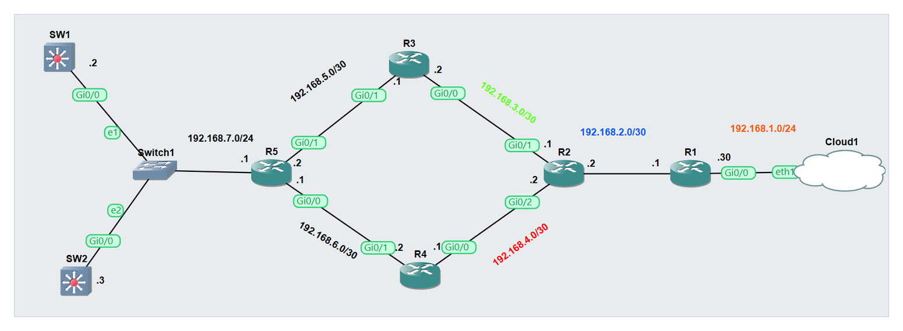

### Plan d'adressage

| Équipement | Interface | Adresse IP | Réseau | Rôle |
|---|---|---|---|---|
| R1 | Gi0/0 | 192.168.1.30 | 192.168.1.0/24 | Lien vers `Cloud1` (réseau local) |
| R1 | Gi1/0 | 192.168.2.1 | 192.168.2.0/30 | Lien vers R2 |
| R2 | Gi0/0 · Gi0/1 · Gi0/2 | 192.168.2.2 · 192.168.3.1 · 192.168.4.2 | /30 | Liens vers R1, R3, R4 |
| R3 | Gi0/0 · Gi0/1 | 192.168.3.2 · 192.168.5.2 | /30 | Liens vers R2, R5 |
| R4 | Gi0/0 · Gi0/1 | 192.168.4.1 · 192.168.6.2 | /30 | Liens vers R2, R5 |
| R5 | Gi0/0 · Gi0/1 · Gi0/2 | 192.168.7.1 · 192.168.5.1 · 192.168.6.1 | 192.168.7.0/24 · /30 | Passerelle du LAN, liens vers R3, R4 |
| SW1 / SW2 | VLAN 1 | 192.168.7.2 / 192.168.7.3 | 192.168.7.0/24 | Switchs du LAN |

### Services de support (machines virtuelles Linux)

| Service | Adresse | Détails |
|---|---|---|
| Serveur de l'application (FastAPI) | `192.168.1.17` | Nom `oussama.ensaf`, port 8000, récepteur de traps SNMP sur UDP 1162 |
| Serveur **NTP** | `192.168.1.18` | Ubuntu Server avec **Chrony** |
| Serveur **DNS** | `192.168.1.19` | BIND, zone directe et inverse `oussama.ensaf` |

### Prérequis côté équipements

Chaque équipement doit être joignable depuis le PC qui exécute l'application, avec SSH activé. Exemple minimal sur un routeur Cisco IOS :

```text
hostname R1
ip domain-name lab.local
username <utilisateur> privilege 15 secret <mot_de_passe>
crypto key generate rsa modulus 2048
ip ssh version 2
line vty 0 4
 login local
 transport input ssh
interface GigabitEthernet0/0
 ip address 192.168.1.30 255.255.255.0
 no shutdown
```

Pour les traps SNMP, pointer les équipements vers l'IP du PC sur le port **UDP 1162** :

```text
snmp-server community public RO
snmp-server host <IP_DU_PC> version 2c public udp-port 1162
snmp-server enable traps
```

---

## 🏗️ Architecture

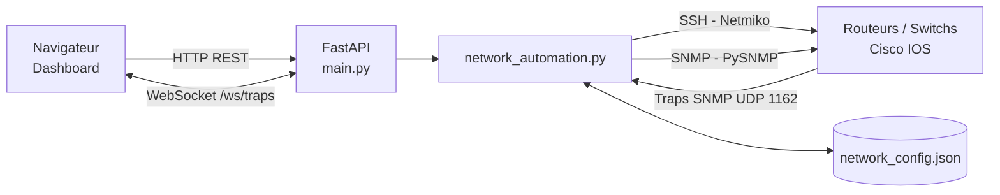

### Fonctionnement

1. Le navigateur envoie une action à l'API REST (`POST /api/...`) ;
2. `main.py` valide la requête et appelle la classe `InteractiveNetworkAutomation` ;
3. `network_automation.py` ouvre une session SSH avec Netmiko, exécute les commandes, puis ferme la session ;
4. Le résultat est renvoyé en JSON et affiché dans la zone de sortie du dashboard ;
5. Chaque action est enregistrée dans l'historique des sessions ;
6. En parallèle, un récepteur SNMP écoute sur **UDP 1162** et diffuse les traps aux navigateurs connectés via WebSocket.

Le frontend est servi par FastAPI depuis le dossier `static/`.

---

## 🧰 Stack technique

| Composant | Version | Rôle |
|---|---|---|
| Python | 3.10 / 3.11 | Langage principal |
| FastAPI | 0.116.1 | API REST et serveur web |
| Uvicorn | 0.35.0 | Serveur ASGI |
| Netmiko | 4.6.0 | Connexions SSH multi-constructeurs |
| PySNMP | 4.4.12 | SNMP (découverte, traps) |
| PySMI / PyASN1 | 1.6.2 / 0.4.8 | Dépendances SNMP |
| Schedule | 1.2.2 | Sauvegardes planifiées |
| HTML / CSS / JavaScript | Vanilla | Dashboard et WebSocket |

---

## 📋 Prérequis

- **Python 3.10 ou 3.11** (testé avec Python 3.10) ;
- **GNS3** avec des images Cisco IOS (routeurs et switchs) ;
- **SSH activé** sur les équipements Cisco ;
- **SNMP** activé si vous utilisez la découverte ou les traps ;
- **Git** pour récupérer le projet.

---

## 🚀 Installation

### 1. Cloner le dépôt

```bash
git clone https://github.com/Oussamaelhilali2025/gns3-network-automation.git
cd gns3-network-automation
```

### 2. Créer l'environnement virtuel

**Windows (PowerShell / CMD) :**

```bat
python -m venv .venv
.venv\Scripts\activate
```

**Linux / macOS :**

```bash
python3 -m venv .venv
source .venv/bin/activate
```

### 3. Installer les dépendances

```bash
python -m pip install --upgrade pip
pip install -r requirements.txt
```

### 4. Créer le fichier de configuration local

**Windows :**

```bat
copy config.example.json network_config.json
```

**Linux / macOS :**

```bash
cp config.example.json network_config.json
```

### 5. Lancer l'application

**Windows :**

```bat
set PYTHONUTF8=1
uvicorn main:app --reload --host 127.0.0.1 --port 8000
```

**Linux / macOS :**

```bash
export PYTHONUTF8=1
uvicorn main:app --reload --host 127.0.0.1 --port 8000
```

Puis ouvrir :

- **Dashboard** : <http://127.0.0.1:8000/static/index.html>
- **Documentation API (Swagger)** : <http://127.0.0.1:8000/docs>

> 🧪 **Dans le lab GNS3**, l'application tourne sur une machine du réseau `192.168.1.0/24`. Pour que les équipements puissent envoyer leurs traps et que le dashboard soit accessible depuis le LAN, lancer avec `--host 0.0.0.0` (voir l'avertissement de la section [Sécurité](#-sécurité)).
>
> 💡 Sur Windows, double-cliquer sur `run.bat` suffit : il crée le venv, installe les dépendances, copie la configuration d'exemple et lance l'application.

Au démarrage, Uvicorn charge la configuration et annonce l'écoute des traps SNMP sur UDP 1162 :

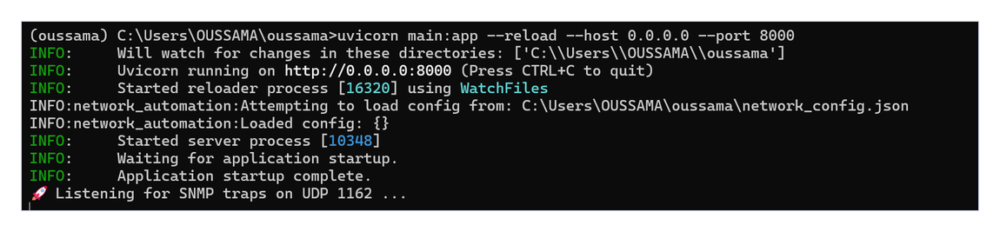

---

## ⚙️ Configuration

Deux méthodes sont disponibles :

1. **Via l'interface** : section **Add Device**, puis saisir l'IP, le nom d'utilisateur, le mot de passe et le type d'équipement.
2. **Via le fichier** `network_config.json` (créé à partir de `config.example.json`).

Exemple :

```json
{
    "default_snmp_community": "public",
    "devices": {
        "192.168.1.10": {
            "username": "cisco",
            "password": "change-me",
            "secret": "",
            "device_type": "cisco_ios",
            "snmp_community": "public"
        }
    }
}
```

| Champ | Description |
|---|---|
| `default_snmp_community` | Communauté SNMP utilisée si l'équipement n'en définit pas |
| `username` / `password` | Identifiants SSH de l'équipement |
| `secret` | Mot de passe du mode privilégié (`enable`), facultatif |
| `device_type` | Type Netmiko (`cisco_ios`, `cisco_xe`, `cisco_nxos`, etc.) |
| `snmp_community` | Communauté SNMPv2c de l'équipement |

> 🔐 `network_config.json` contient des identifiants en clair. Il est **ignoré par Git** (voir `.gitignore`) et ne doit jamais être publié.

---

## 🖥️ Utilisation

### Démarrage rapide

1. **Ajouter un équipement** dans *Add Device*.
2. **Sélectionner l'équipement courant** avec son IP, puis cliquer sur *Set Current Device*.
3. **Tester la connectivité SSH** avant toute configuration.
4. Utiliser les sections du menu pour configurer interfaces, routage, VLAN, DHCP, NTP, etc.
5. Consulter les **traps SNMP** en temps réel dans *SNMP Traps*.
6. Sauvegarder les configurations dans *Backup/Restore* et consulter l'historique.

### Cas d'usage détaillés

**Ajouter et tester un équipement**

Saisir l'IP, les identifiants et le type d'équipement, puis tester la connexion SSH.

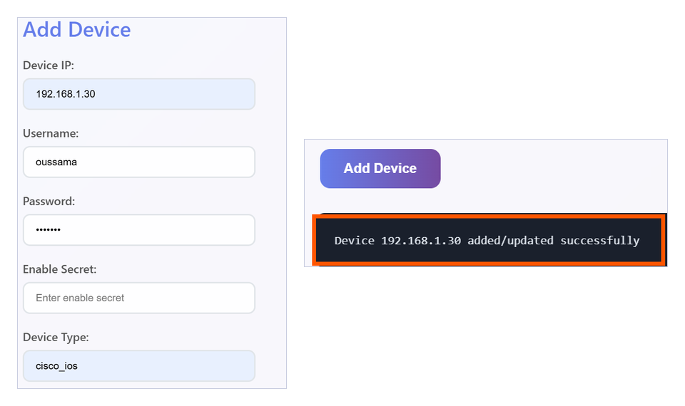

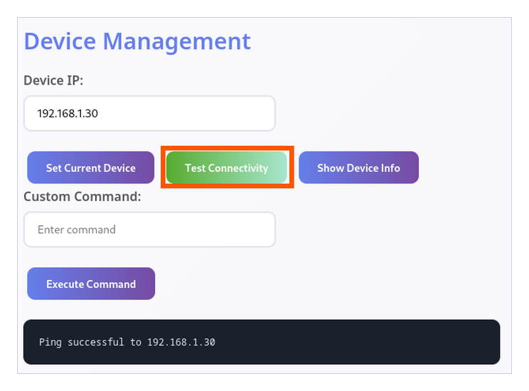

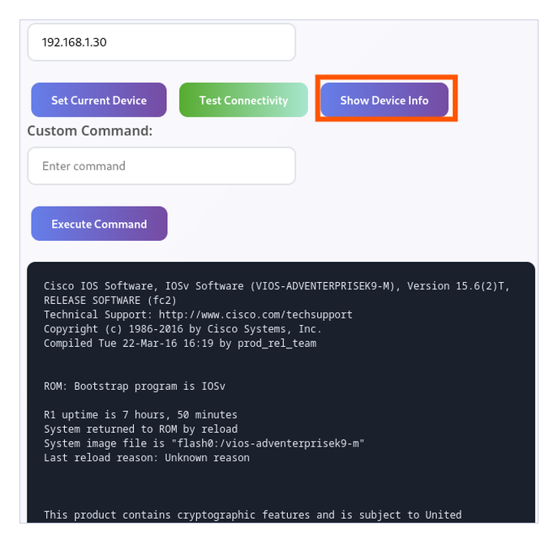

**Accéder à l'application par son nom (DNS)**

Le serveur DNS du lab résout `oussama.ensaf` vers `192.168.1.17` : la capture Wireshark montre la requête et la réponse.

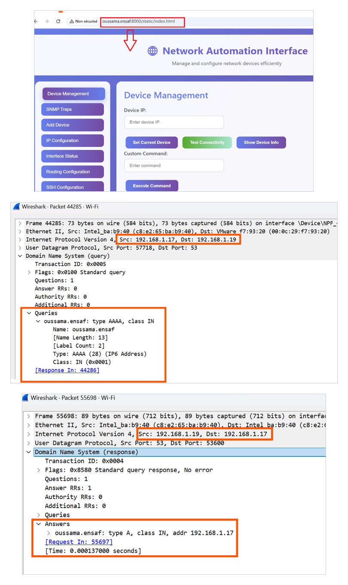

**Configurer une adresse IP**

Choisir l'interface, l'adresse et le masque ; l'application envoie les commandes et affiche le résultat. Une commande personnalisée (`sh ip inter br`) permet de vérifier l'état des interfaces.

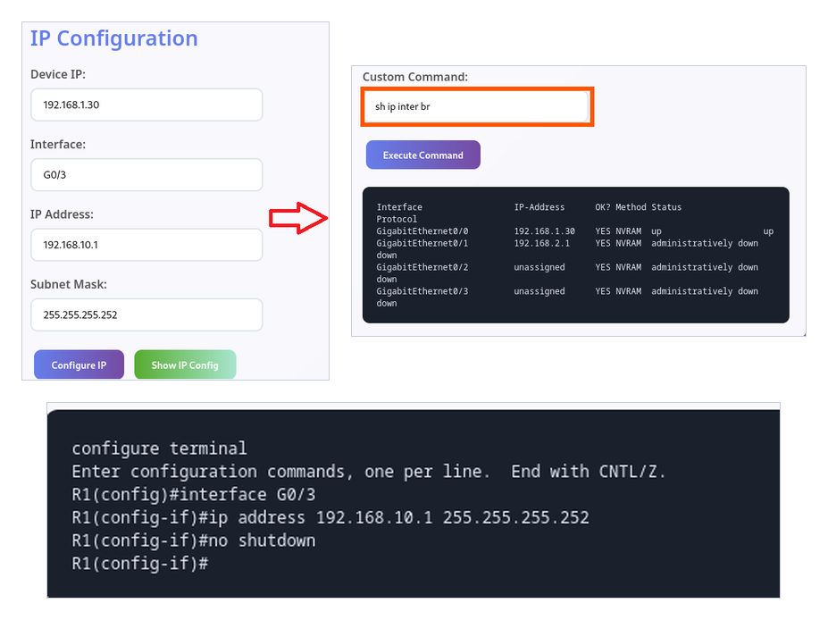

**Gérer les interfaces et créer une loopback**

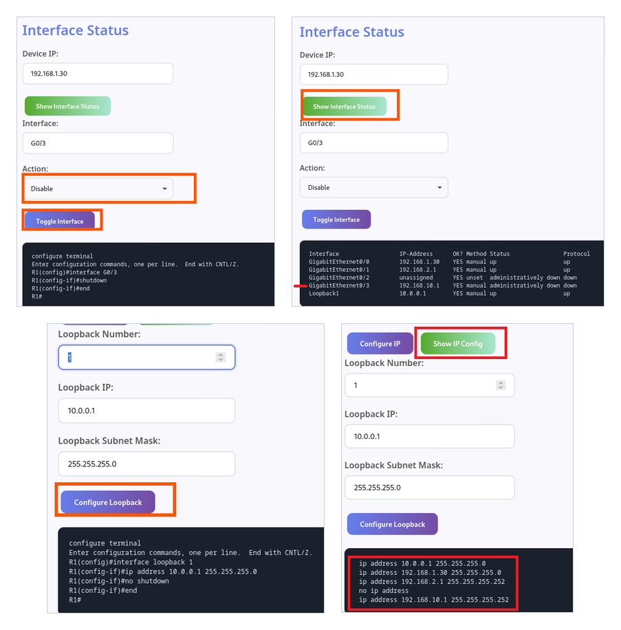

**Configurer SSH et SNMPv2c**

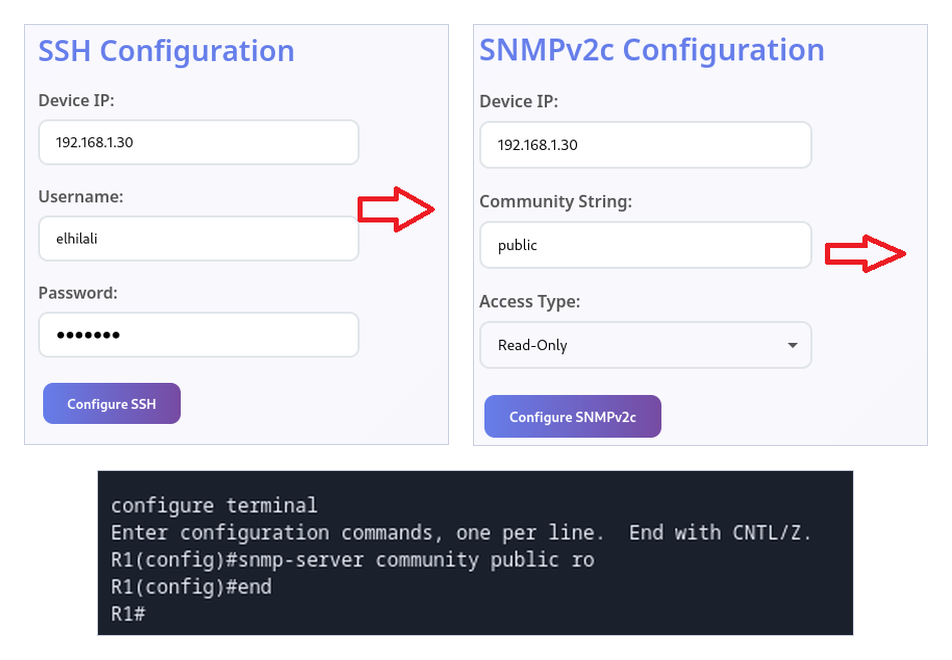

**Configurer le routage (OSPF, EIGRP, BGP, statique)**

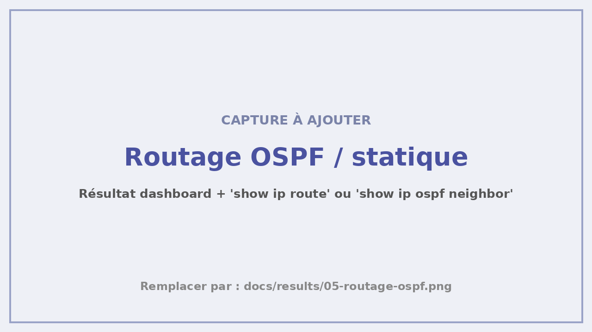

**Créer des VLAN et affecter un port**

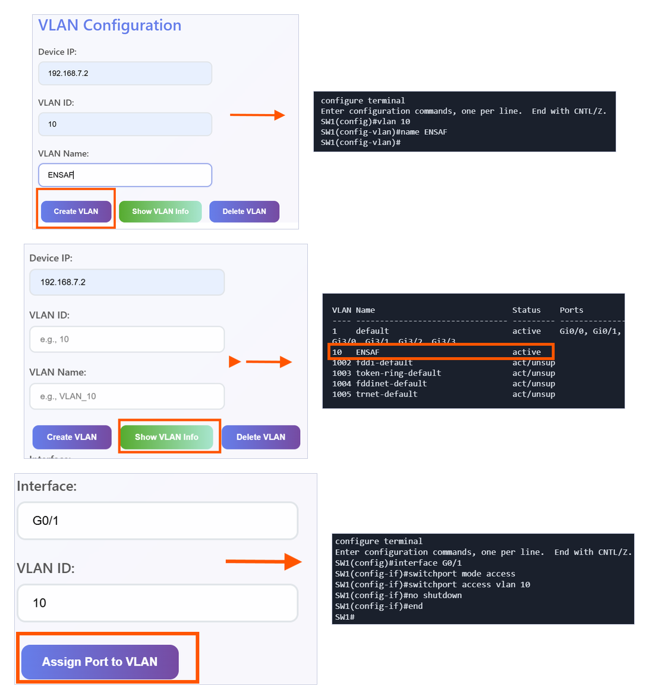

**Créer un pool DHCP**

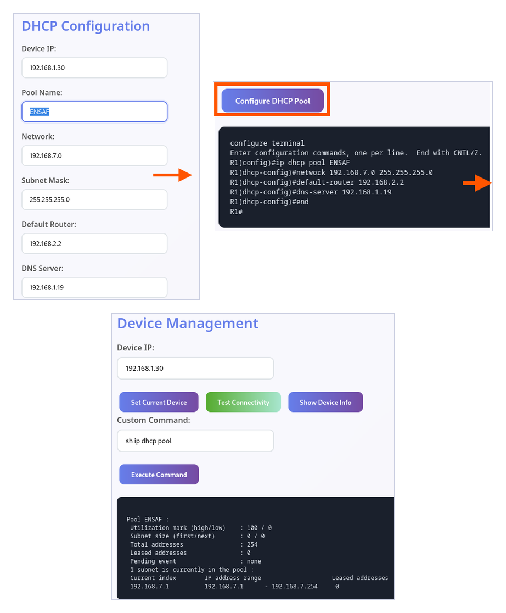

**Découvrir le réseau**

Le *ping sweep* balaie une plage d'adresses (ex. `192.168.1.1` à `192.168.1.50`), le *scan de ports* teste une liste de ports TCP, la *découverte SNMP* lit `sysDescr`, et *Show Neighbors* affiche les voisins CDP / LLDP.

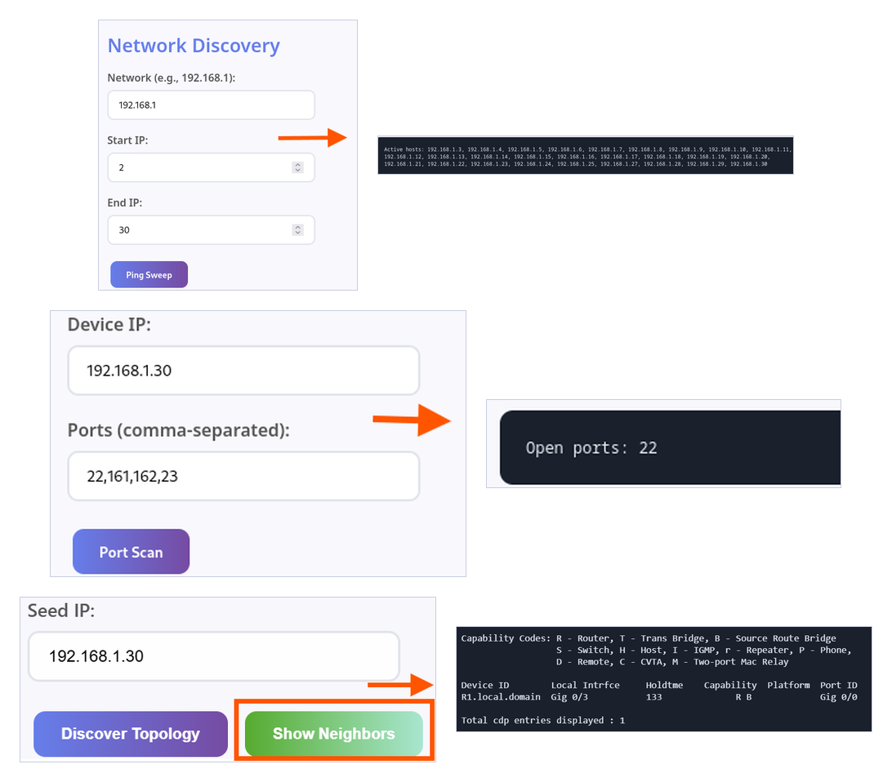

**Recevoir des traps SNMP en temps réel**

Le dashboard se connecte au WebSocket `/ws/traps` ; chaque trap reçu par l'application sur UDP 1162 apparaît instantanément.

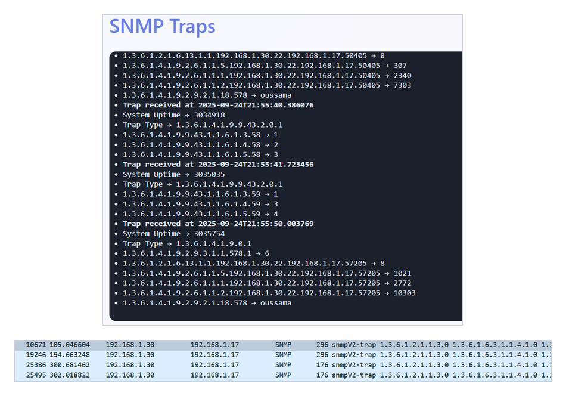

**Sauvegarder, restaurer et comparer les configurations**

La sauvegarde exécute `show running-config` et crée un fichier `config_<IP>_<date>_<heure>.txt` à la racine du projet. La comparaison affiche un diff entre deux fichiers.

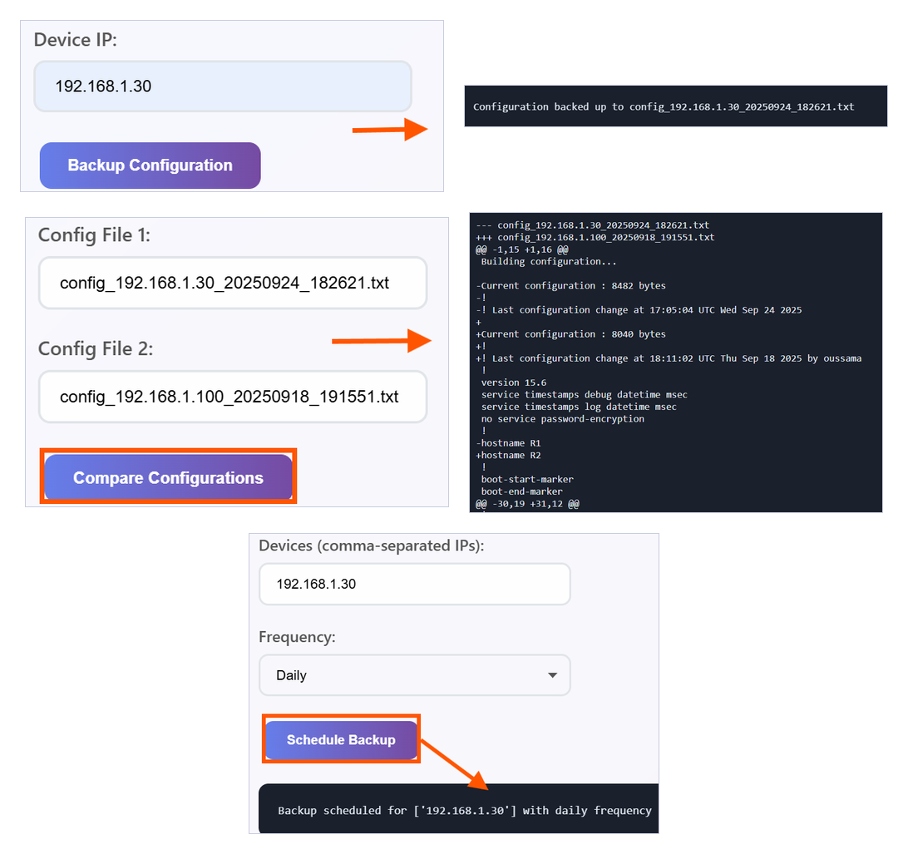

**Vérifier la synchronisation NTP**

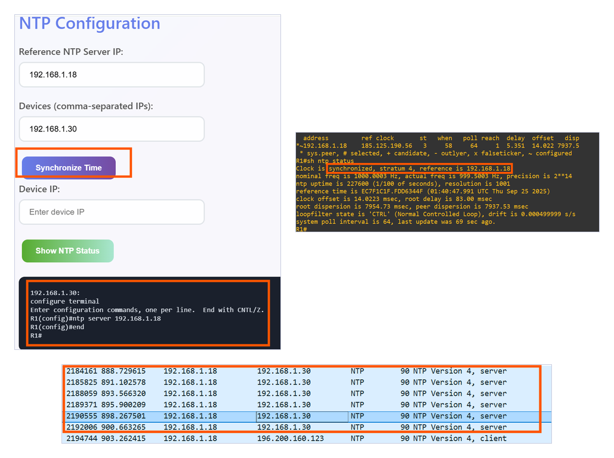

**Consulter l'historique et les ressources système**


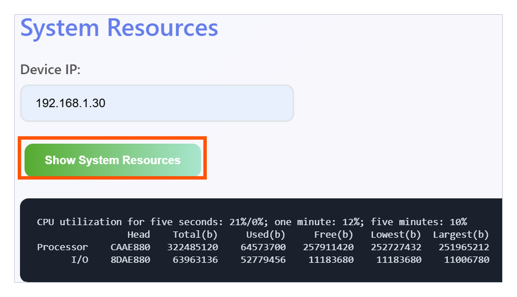

---

## 📊 Résultats obtenus

| Test | Résultat observé | Capture |
|---|---|---|
| Résolution DNS de `oussama.ensaf` | Requête DNS et réponse `192.168.1.17` capturées dans Wireshark | `15-resolution-dns.png` |
| Ajout d'un équipement | Message « Device 192.168.1.30 added/updated successfully » | `01-ajout-equipement.png` |
| Connexion SSH | « Ping successful », infos Cisco IOS affichées | `02-…`, `03-…` |
| Configuration IP | `192.168.10.1/30` appliquée sur G0/3, interface `up` | `04-configuration-ip.png` |
| VLAN | VLAN 10 `ENSAF` créé et visible dans `show vlan`, port affecté | `06-vlan-trunk.png` |
| DHCP | Pool `ENSAF` créé (`192.168.7.0/24`, passerelle, DNS) | `07-dhcp.png` |
| Découverte | Hôtes actifs détectés, port 22 ouvert, voisin CDP R1 | `08-decouverte-reseau.png` |
| Traps SNMP | Traps reçus en temps réel dans le dashboard | `09-snmp-traps-temps-reel.png` |
| Sauvegarde | Fichier `config_<IP>_<date>.txt` créé, diff entre deux fichiers | `10-sauvegarde-restauration.png` |
| NTP | Horloge `synchronized, stratum 4, reference is 192.168.1.18` | `11-ntp-statut.png` |
| Ressources système | CPU et mémoire affichés | `13-ressources-systeme.png` |

> 📷 Captures encore à ajouter : `05-routage-ospf.png` (routage) et `12-historique-sessions.png` (historique des sessions). Voir [`docs/results/`](docs/results).

---

## 🔌 API

L'API expose **43 routes REST** et **1 WebSocket**. La documentation interactive complète est disponible sur **`/docs`**.

### Équipements

| Méthode | Route | Description |
|---|---|---|
| `POST` | `/api/add_device` | Ajouter un équipement |
| `POST` | `/api/set_current_device` | Définir l'équipement courant |
| `GET` | `/api/current_device` | Lire l'équipement courant |
| `POST` | `/api/test_connectivity` | Tester la connexion SSH |
| `POST` | `/api/show_device_info` | Informations système |
| `POST` | `/api/execute_custom_command` | Exécuter une commande personnalisée |
| `POST` | `/api/configure_ssh` | Configurer SSH |
| `POST` | `/api/configure_snmp` | Configurer SNMPv2c |
| `POST` | `/api/system_resources` | CPU, mémoire, processus |

### Interfaces et IP

| Méthode | Route | Description |
|---|---|---|
| `POST` | `/api/show_interface_status` | État des interfaces |
| `POST` | `/api/configure_interface_ip` | Configurer une adresse IP |
| `POST` | `/api/show_ip_configuration` | Afficher la configuration IP |
| `POST` | `/api/configure_loopback` | Configurer une loopback |
| `POST` | `/api/toggle_interface` | Activer / désactiver une interface |
| `POST` | `/api/mass_interface_config` | Configuration d'interfaces en masse |
| `POST` | `/api/configure_dhcp_pool` | Créer un pool DHCP |

### Routage

| Méthode | Route | Description |
|---|---|---|
| `POST` | `/api/configure_static_route` | Route statique |
| `POST` | `/api/configure_ospf` | OSPF |
| `POST` | `/api/configure_eigrp` | EIGRP |
| `POST` | `/api/configure_bgp` | BGP |
| `POST` | `/api/show_routing_table` | Table de routage |
| `POST` | `/api/show_routing_protocols` | Protocoles de routage |

### VLAN

| Méthode | Route | Description |
|---|---|---|
| `POST` | `/api/create_vlan` | Créer un VLAN |
| `POST` | `/api/delete_vlan` | Supprimer un VLAN |
| `POST` | `/api/assign_port_to_vlan` | Affecter un port à un VLAN |
| `POST` | `/api/configure_trunk_port` | Configurer un trunk |
| `POST` | `/api/show_vlan_info` | Informations VLAN |
| `POST` | `/api/show_vlan_database` | Base de données VLAN |

### Découverte et supervision

| Méthode | Route | Description |
|---|---|---|
| `POST` | `/api/ping_sweep` | Balayage ping |
| `POST` | `/api/port_scan` | Scan de ports TCP |
| `POST` | `/api/snmp_discovery` | Découverte SNMP |
| `POST` | `/api/show_neighbors` | Voisins CDP / LLDP |
| `POST` | `/api/discover_topology` | Découverte de topologie |
| `POST` | `/api/show_session_history` | Historique des sessions |
| `WS` | `/ws/traps` | Traps SNMP en temps réel |

### Sauvegarde, NTP et multi-équipements

| Méthode | Route | Description |
|---|---|---|
| `POST` | `/api/backup_configuration` | Sauvegarder une configuration |
| `POST` | `/api/restore_configuration` | Restaurer une configuration |
| `POST` | `/api/compare_configurations` | Comparer deux configurations |
| `POST` | `/api/schedule_backup` | Planifier des sauvegardes |
| `POST` | `/api/synchronize_time` | Synchroniser l'heure |
| `POST` | `/api/show_ntp_status` | Statut NTP |
| `POST` | `/api/multi_device_command` | Commande sur plusieurs équipements |
| `POST` | `/api/bulk_configuration` | Configuration groupée |
| `POST` | `/api/network_wide_vlan` | VLAN sur plusieurs switchs |

---

## 🗂️ Structure du projet

```text
gns3-network-automation/
├── main.py                     # API FastAPI et routes REST
├── network_automation.py       # Logique Netmiko / PySNMP
├── static/
│   └── index.html              # Dashboard (HTML / CSS / JS)
├── docs/
│   ├── screenshots/            # Captures de l'interface
│   │   ├── dashboard.png
│   │   ├── routing.png
│   │   ├── vlan.png
│   │   ├── discovery.png
│   │   └── backup.png
│   └── results/                # Captures des résultats dans le lab GNS3
│       ├── 00-topologie-gns3.png … 04-configuration-ip.png
│       ├── 05-routage-ospf.png          # à ajouter
│       ├── 06-vlan-trunk.png … 11-ntp-statut.png
│       ├── 12-historique-sessions.png   # à ajouter
│       └── 13-ressources-systeme.png … 17-interfaces-loopback.png
├── config.example.json         # Modèle de configuration
├── requirements.txt
├── run.bat                     # Lancement automatique (Windows)
├── .gitignore
├── LICENSE
└── README.md
```

Fichiers générés à l'exécution (ignorés par Git) : `network_config.json`, `config_<IP>_<date>.txt`, `*.log`.

---

## 🔒 Sécurité

Ce projet est **pédagogique** et ne doit pas être exposé tel quel sur Internet.

- L'application **n'a pas d'authentification** : gardez-la sur `127.0.0.1` ou dans un réseau de lab isolé.
- Le middleware CORS autorise toutes les origines (`allow_origins=["*"]`). À restreindre en production.
- Les identifiants des équipements sont stockés **en clair** dans `network_config.json`. Protégez ce fichier et ne le versionnez jamais.
- Les sauvegardes `config_*.txt` contiennent la configuration complète des équipements : ne les publiez pas.
- La communauté SNMP par défaut est `public`. Changez-la dans votre lab.
- Pour un usage réel : authentification (JWT), HTTPS, stockage chiffré, SNMPv3 et clés SSH.
- N'utilisez cet outil que sur des équipements que vous êtes autorisé à administrer.

---

## 🛠️ Dépannage

| Problème | Solution |
|---|---|
| `Config file not found` | Copier `config.example.json` vers `network_config.json` |
| `UnicodeEncodeError` au démarrage | Définir `PYTHONUTF8=1` avant de lancer Uvicorn |
| Timeout SSH | Vérifier l'IP GNS3, `ip ssh`, les identifiants, `transport input ssh` et les ACL |
| Authentification SSH refusée | Vérifier `username`, `password` et `secret` dans la configuration |
| Timeout SNMP | Vérifier la communauté, UDP 161 et les ACL |
| Aucun trap reçu | Vérifier `snmp-server host ... udp-port 1162`, le pare-feu Windows (UDP 1162) et l'IP du PC |
| Port 8000 déjà utilisé | Lancer avec `--port 8001` |
| Erreur d'installation de PySNMP | Utiliser Python 3.10 ou 3.11 |
| Équipements GNS3 injoignables | Vérifier le lien `Cloud` / Loopback et que le PC est dans le même sous-réseau |

---

## 🗺️ Améliorations possibles

- Authentification et gestion des rôles ;
- Stockage des configurations dans une base de données ;
- HTTPS et reverse proxy ;
- Conteneurisation Docker ;
- Tests unitaires et d'intégration ;
- Support SNMPv3 ;
- Dossier `backups/` dédié pour les sauvegardes ;
- Interface en anglais / français.

---

## 📄 Licence

Ce projet est distribué sous licence **MIT**. Voir le fichier [LICENSE](LICENSE).

---

## 👤 Auteur

**Oussama El Hilali**

Projet réalisé dans le cadre d'un **stage d'initiation** — 2025-2026.

---

## 🙏 Remerciements

- [GNS3](https://www.gns3.com/)
- [FastAPI](https://fastapi.tiangolo.com/)
- [Netmiko](https://github.com/ktbyers/netmiko)
- [PySNMP](https://pysnmp.readthedocs.io/)
